<a href="https://ugurcandede.github.io">
  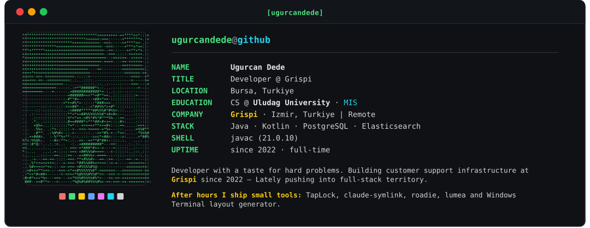
</a>

  

  <a href="https://github.com/ugurcandede">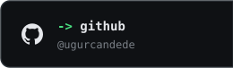</a><a href="https://www.instagram.com/ugurcan.dede/">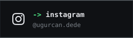</a><a href="https://www.linkedin.com/in/ugurcandede/">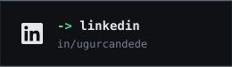</a><a href="https://ugurcandede.github.io">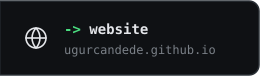</a>

  

  <a href="https://github.com/ugurcandede/taplock-app">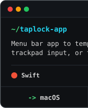</a><a href="https://github.com/ugurcandede/taplock-windows">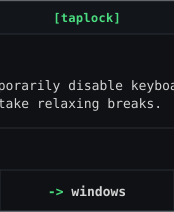</a><a href="https://ugurcandede.github.io/taplock-app/">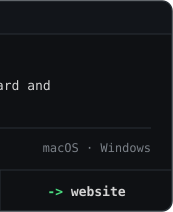</a>
  <a href="https://github.com/ugurcandede/lumea">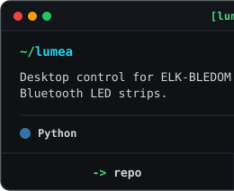</a><a href="https://ugurcandede.github.io/lumea/">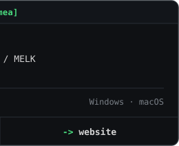</a>
   
  <a href="https://github.com/ugurcandede/sotto">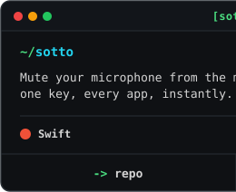</a><a href="https://ugurcandede.github.io/sotto/">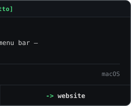</a>
  <a href="https://github.com/ugurcandede/roadie">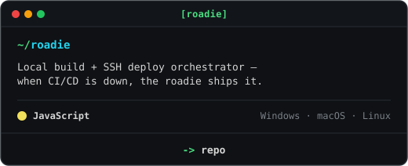</a>
   
  <a href="https://github.com/ugurcandede/cc-cost">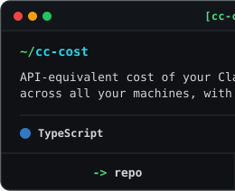</a><a href="https://www.npmjs.com/package/@ugurcandede/cc-cost">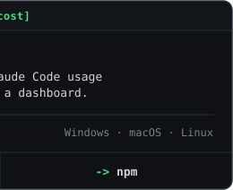</a>
  <a href="https://github.com/ugurcandede/claude-symlink">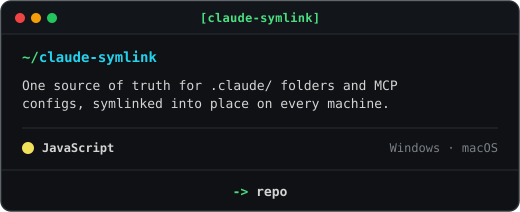</a>
   
  <a href="https://github.com/ugurcandede/windows-terminal-multi-panel-setup-generator">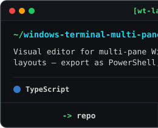</a><a href="https://ugurcandede.github.io/windows-terminal-multi-panel-setup-generator/">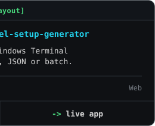</a>
  <a href="https://github.com/ugurcandede/s3-presigned-url-proxy">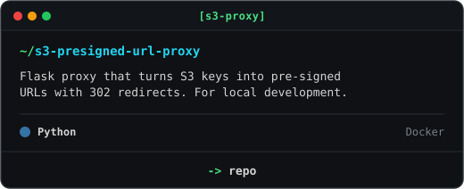</a>

